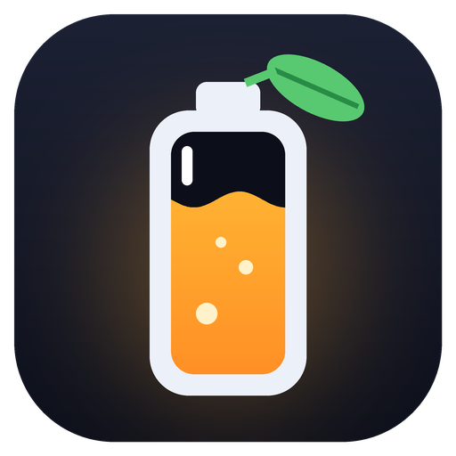

<p align="center">
  
</p>

<h1 align="center">Juice-Mate</h1>

<p align="center">
  Battery levels, Claude usage limits and system sensors — right on the Windows taskbar,<br>
  drawn in the taskbar's own style.
</p>

<p align="center">
  
</p>

## What it shows

| Where | What |
| ----- | ---- |
| **By the clock** | Battery % of every Bluetooth device that reports one — headphones, keyboard, mouse, gamepad, phone — and HATOR wireless mice through their dongle. Claude's 5-hour and weekly limits (✳ `5h`, ✳ `7d`). |
| **At the left end** | Upload and download speed, CPU, GPU, GPU temperature, memory, disk — pick them in the menu under **Show**. |

- **Looks like Windows.** The system's own glyph font and text colour, no boxes, follows the light or
  dark theme. Hover for details; click to open Bluetooth settings, Task Manager or the Claude usage page.
- **Red means act now.** A battery under 20 %, a Claude window past 80 % — or one that will run out
  before it resets at the pace of the last hour — a load over 95 %, a GPU over 85 °C.
- **Notifications** when a battery runs low, when a Claude window is about to run out, and when a
  spent window is back.
- **Nothing to set up.** Every source finds what is present; a device that is not there simply does
  not appear. A disconnected device disappears too.

### Claude usage

Juice-Mate reads the same numbers as Claude Code's `/usage`, with Claude Code's own login — it never
refreshes or changes that login. When the login's token has expired, Juice-Mate runs Claude Code
once, invisibly, and Claude Code renews it itself.

With **Keep Claude's 5-hour window running** ticked in the menu, it also starts a new 5-hour window
whenever the last one has ended — and makes the request worth something: it reads the day's
headlines from The Verge, TechCrunch and Engadget and tells you the two tech stories that matter
most, as a notification. **Ask Claude now** does it on demand. Each run costs a fraction of a
percent of the window.

The question is yours to change: `claude_prompt` in `%APPDATA%\JuiceMate\settings.json`, where
`{news}` stands for the headlines and an empty string means "just keep the window, quietly".

## Install

Download **`JuiceMate-win-Setup.exe`** from the [latest release](https://github.com/Zebaro24/Juice-Mate/releases/latest)
and run it. No administrator rights, no prompts: it installs for your user only and starts at once.

- **Updates itself** from GitHub Releases in the background; **Restart to update** appears in the
  menu when a new version is ready.
- **Start with Windows** is a checkbox in the menu.
- Uninstall from Windows Settings → Apps, like any other app.

Windows 11 is the main target; on Windows 10, or with a left-aligned taskbar, everything sits by the
clock.

## The menu

Right-click any number on the panel:

```
Show                                  ▸  sensors to show, with checkmarks
Refresh now
Ask Claude now                           (when Claude Code is installed)
Keep Claude's 5-hour window running   ✓
Start with Windows                    ✓
─────────────
Quit Juice-Mate
```

## Development

Python 3.13 and Poetry.

```bash
poetry install
poetry run python -m juice_mate --dump   # print every reading once
scripts\run.bat                          # run on the taskbar, without a console
python scripts/gate.py                   # the only checker: lint, types, tests, docs
```

A tag `vX.Y.Z` builds the release in CI (PyInstaller + Velopack) and publishes it to GitHub Releases.
How it works inside: [docs/architecture.md](docs/architecture.md). What is next: [docs/plan](docs/plan/README.md).
